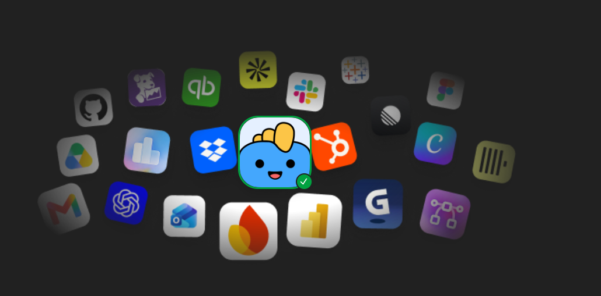
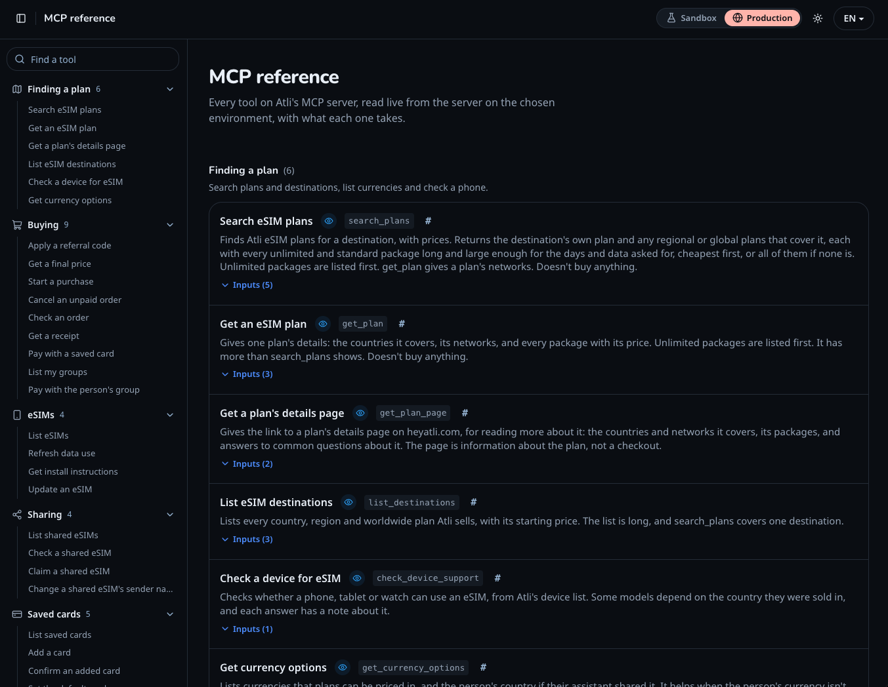

<p align="center">
  
</p>

<h1 align="center">eSIM MCP</h1>

<p align="center">
  <b>Find, buy and install travel eSIMs from your AI assistant.</b><br>
  One remote MCP server for Claude, ChatGPT, Gemini, Cursor, VS Code and any other MCP client.
</p>

<p align="center">
  <code>https://mcp.heyatli.com</code>
</p>

<p align="center">
  <a href="#quick-start">Quick start</a> ·
  <a href="#connect-your-client">Connect your client</a> ·
  <a href="#what-you-can-ask">What you can ask</a> ·
  <a href="#try-it-mcp-reference-and-sandbox">Try it</a> ·
  <a href="#tools">Tools</a> ·
  <a href="#signing-in">Signing in</a> ·
  <a href="#payments-and-safety">Payments and safety</a> ·
  <a href="#faq">FAQ</a>
</p>

---

The eSIM MCP server is [Atli](https://heyatli.com)'s public [Model Context Protocol](https://modelcontextprotocol.io) server.
Add it to your assistant once, then just ask: _"I'm going to Japan for 10 days, which eSIM should I get?"_ The assistant
searches Atli's plans in your currency, checks that your phone supports eSIM, gets you a final price, hands you a secure
payment link, and walks you through installing the eSIM once you've paid.

- **No account needed to start.** Browse and buy as a guest, or sign in with Atli for your eSIMs in every chat.
- **Nothing is paid without your yes.** You pay on Atli's Stripe-hosted page, or the assistant charges a saved card only after
  telling you the price and the card.
- **Your card never passes through the chat.** Stripe handles it. Atli never receives the full number.
- **59 tools**, from searching plans to running a company's eSIM group.
- **Free to add.** You pay only for the eSIM you buy.

This repository is documentation only: the server is hosted by Atli, so there is nothing to install or run.

> [!TIP]
> Building your own eSIM store, app or bot rather than using an assistant? See
> [Forgesoft-ai/esim-api](https://github.com/Forgesoft-ai/esim-api) for Atli's white-label API, embeddable widget and partner
> program.

## Quick start

| What                 | Value                                                                 |
| -------------------- | --------------------------------------------------------------------- |
| Server address       | `https://mcp.heyatli.com`                                             |
| Transport            | Streamable HTTP (remote MCP)                                          |
| Authentication       | None to start. OAuth 2.1 sign-in is optional, and offered when needed |
| With a referral code | `https://mcp.heyatli.com/r/YOUR_CODE`                                 |
| Product page         | [heyatli.com/mcp](https://heyatli.com/mcp)                            |

Paste the address wherever your app adds a **remote MCP server**, **custom connector** or **custom app**. Leave
authentication empty: the server asks you to sign in by itself if and when a tool needs your account.

The fastest way, if you use Claude Code:

```bash
claude mcp add --transport http atli https://mcp.heyatli.com
```

## Connect your client

Assistant apps move their menus from time to time. If a step below doesn't match what you see, search the app's help for
"custom connector" or "remote MCP server".

<details open>
<summary><b>Claude</b> (claude.ai, desktop and mobile)</summary>

1. Open **Customize**, then **Connectors**.
2. Choose **Add custom connector**.
3. Name it `Atli`, paste `https://mcp.heyatli.com`, and add it.
4. In a chat, make sure Atli is switched on in the tools menu, then ask about an eSIM for your trip.

Claude asks you to sign in to Atli when a tool needs your account. Connectors added on claude.ai also appear in the
desktop and mobile apps. Your Claude plan may limit how many custom connectors you can add.

</details>

<details>
<summary><b>Claude Code</b></summary>

```bash
claude mcp add --transport http atli https://mcp.heyatli.com
```

Add `--scope user` to have it in every project, or `--scope project` to share it with your team through `.mcp.json`:

```json
{
  "mcpServers": {
    "atli": {
      "type": "http",
      "url": "https://mcp.heyatli.com"
    }
  }
}
```

To sign in to your Atli account, run `/mcp` in Claude Code, pick `atli` and choose **Authenticate**.

</details>

<details>
<summary><b>ChatGPT</b></summary>

**From the directory.** Atli is listed in ChatGPT's apps directory as **Atli eSIM**. Search for it, choose **Connect**,
and pick it from the **+** menu in a new chat.

**By address, with developer mode** (paid plans):

1. Open **Settings → Apps & Connectors → Advanced settings** and turn on **Developer mode**.
2. Under **Apps & Connectors**, choose **Create**. Name it `Atli`, paste `https://mcp.heyatli.com`, and choose
   **No authentication**.
3. In a new chat, open the **+** menu and pick Atli.

</details>

<details>
<summary><b>Gemini</b></summary>

1. Open **Settings & help**, then **Connected Apps**.
2. Under custom apps, choose **Add a custom app** and paste `https://mcp.heyatli.com`.
3. In a new chat, ask about an eSIM for your trip.

Custom apps need a personal Google account with Google AI Pro or Ultra, in the US, with Keep Activity on.

</details>

<details>
<summary><b>Gemini CLI</b></summary>

In `~/.gemini/settings.json`:

```json
{
  "mcpServers": {
    "atli": {
      "httpUrl": "https://mcp.heyatli.com"
    }
  }
}
```

</details>

<details>
<summary><b>Muse (Meta)</b></summary>

Ask Muse, in these words:

> Add the Atli MCP from this address: https://mcp.heyatli.com

Confirm it if Muse asks, then ask about an eSIM in a new chat.

</details>

<details>
<summary><b>Cursor</b></summary>

In `~/.cursor/mcp.json` (every project) or `.cursor/mcp.json` (one project):

```json
{
  "mcpServers": {
    "atli": {
      "url": "https://mcp.heyatli.com"
    }
  }
}
```

Or open **Cursor Settings → Tools & MCP → New MCP Server** and paste the same.

</details>

<details>
<summary><b>VS Code (GitHub Copilot)</b></summary>

In `.vscode/mcp.json`, or run **MCP: Add Server** from the Command Palette and choose **HTTP**:

```json
{
  "servers": {
    "atli": {
      "type": "http",
      "url": "https://mcp.heyatli.com"
    }
  }
}
```

Then switch Copilot Chat to **Agent** mode and turn on Atli's tools.

</details>

<details>
<summary><b>Windsurf</b></summary>

In `~/.codeium/windsurf/mcp_config.json`:

```json
{
  "mcpServers": {
    "atli": {
      "serverUrl": "https://mcp.heyatli.com"
    }
  }
}
```

</details>

<details>
<summary><b>OpenAI Codex CLI</b></summary>

In `~/.codex/config.toml`:

```toml
[mcp_servers.atli]
url = "https://mcp.heyatli.com"
```

Or run `codex mcp add atli --url https://mcp.heyatli.com`.

</details>

<details>
<summary><b>Zed</b></summary>

In Zed's `settings.json`:

```json
{
  "context_servers": {
    "atli": {
      "url": "https://mcp.heyatli.com"
    }
  }
}
```

</details>

<details>
<summary><b>Goose</b></summary>

Run `goose configure`, choose **Add Extension → Remote Extension (Streamable HTTP)**, name it `atli` and paste
`https://mcp.heyatli.com`.

</details>

<details>
<summary><b>Clients that only run local (stdio) servers</b></summary>

Bridge the remote server with [`mcp-remote`](https://www.npmjs.com/package/mcp-remote), which needs Node.js 18 or later. For
example, in Claude Desktop's `claude_desktop_config.json`:

```json
{
  "mcpServers": {
    "atli": {
      "command": "npx",
      "args": ["-y", "mcp-remote", "https://mcp.heyatli.com"]
    }
  }
}
```

The same `command` and `args` work in any client that takes a stdio server. `mcp-remote` opens your browser when you
sign in.

</details>

<details>
<summary><b>Your own agent</b> (MCP SDKs)</summary>

TypeScript, with [`@modelcontextprotocol/sdk`](https://www.npmjs.com/package/@modelcontextprotocol/sdk):

```ts
import { Client } from "@modelcontextprotocol/sdk/client/index.js";
import { StreamableHTTPClientTransport } from "@modelcontextprotocol/sdk/client/streamableHttp.js";

const client = new Client({ name: "my-travel-agent", version: "1.0.0" });
await client.connect(
  new StreamableHTTPClientTransport(new URL("https://mcp.heyatli.com")),
);

const plans = await client.callTool({
  name: "search_plans",
  arguments: { destination: "Japan", days: 10, currency: "EUR" },
});
console.log(plans.content);
```

Python, with the [`mcp`](https://pypi.org/project/mcp/) package:

```python
import asyncio
from mcp import ClientSession
from mcp.client.streamable_http import streamablehttp_client

async def main():
    async with streamablehttp_client("https://mcp.heyatli.com") as (read, write, _):
        async with ClientSession(read, write) as session:
            await session.initialize()
            tools = await session.list_tools()
            print([t.name for t in tools.tools])

asyncio.run(main())
```

Through the Claude API's [MCP connector](https://docs.claude.com/en/docs/agents-and-tools/mcp-connector), pass it as a
remote server:

```json
"mcp_servers": [
  { "type": "url", "url": "https://mcp.heyatli.com", "name": "atli" }
]
```

Each tool's full input schema is in `tools/list`.

</details>

<details>
<summary><b>Try it from a terminal</b></summary>

List the tools with plain `curl`:

```bash
curl -s https://mcp.heyatli.com \
  -H 'content-type: application/json' \
  -H 'accept: application/json, text/event-stream' \
  -d '{"jsonrpc":"2.0","id":1,"method":"tools/list"}'
```

Or explore them in the [MCP Inspector](https://github.com/modelcontextprotocol/inspector):

```bash
npx @modelcontextprotocol/inspector
```

Choose **Streamable HTTP** and enter `https://mcp.heyatli.com`.

</details>

### With a referral code

Add `/r/YOUR_CODE` to the address, for example `https://mcp.heyatli.com/r/FRIEND10`. The code is linked to each new guest
the connection starts, so its discount applies to their first order. You can also just tell the assistant your code:
it applies it with `apply_referral_code`.

## What you can ask

| Goal             | Try asking                                           |
| ---------------- | ---------------------------------------------------- |
| Find a plan      | "eSIM plans for Japan for 10 days, in euros"         |
| Check your phone | "Can my iPhone 15 Pro use an eSIM?"                  |
| Buy or top up    | "I'll take the unlimited one"                        |
| Install it       | "How do I install my eSIM?"                          |
| Track your data  | "How much data do I have left?"                      |
| Get help         | "My eSIM isn't connecting. What should I try?"       |
| Share an eSIM    | "Buy an eSIM for my sister"                          |
| Use your rewards | "How many points do I have?"                         |
| Get a receipt    | "Show me the receipt for my last order"              |
| Run a group      | "Who in our team group has used most of their data?" |

A typical purchase goes like this:

```text
You    I'm going to Japan for 10 days. Which eSIM should I get?
Atli   search_plans → unlimited and standard packages for Japan, in your currency
You    The unlimited one, please.
Atli   get_quote → final price with any discount
       start_purchase → a secure payment link
You    (pay on Atli's page) Done.
Atli   get_order_status → paid and ready
       get_install_instructions → steps for your phone, a QR code and the manual code
```

## Try it: MCP reference and Sandbox

<p align="center">
  <a href="https://partners.heyatli.com/dev/mcp/reference"></a>
</p>

**[partners.heyatli.com/dev/mcp/reference](https://partners.heyatli.com/dev/mcp/reference)** lists every tool, read
live from the server you pick, with what each one takes. Search by name or words, browse by section in the side
panel, and see at a glance which tools only read, which change things and which are destructive.

Switch the top bar to **Sandbox** to play with the tools for real, without spending money:

- **Try** on any tool opens a form built from its inputs, filled with a sample that gives a real answer. Edit it, run
  it, and read the JSON it sent and the answer beside it.
- Tries run as one **shared Sandbox test account** that already has a saved test card and an eSIM, so account tools
  have something to show.
- Or **sign in with your own Sandbox account** above the list, the same OAuth sign-in an assistant uses, and the tools
  act for that account instead.
- Sandbox is a separate world: its own accounts, test payments only (Stripe's `4242 4242 4242 4242`, any future
  expiry, any CVC), eSIMs from a test carrier that can't be installed on a phone, and no commission.

To point your own client at Sandbox, use its address instead of production's:

| Environment | Address                                  | With a referral code                                 |
| ----------- | ---------------------------------------- | ---------------------------------------------------- |
| Sandbox     | `https://staging.public.mcp.heyatli.com` | `https://staging.public.mcp.heyatli.com/r/YOUR_CODE` |
| Production  | `https://mcp.heyatli.com`                | `https://mcp.heyatli.com/r/YOUR_CODE`                |

[partners.heyatli.com/dev/mcp](https://partners.heyatli.com/dev/mcp) has the setup steps with your partner code
already in the address once you're signed in.

## Tools

Every tool has a title and read-only or destructive hints, so assistants that respect them ask before anything that
changes your account or spends money. Each tool also names its section in `_meta["com.heyatli/section"]`.

### Plans: no account needed

| Tool                   | What it does                                                                                |
| ---------------------- | ------------------------------------------------------------------------------------------- |
| `search_plans`         | Finds plans for a country, region or city, with prices. Unlimited packages are listed first |
| `get_plan`             | One plan's countries, networks and every package with its price                             |
| `get_plan_page`        | The link to a plan's page on heyatli.com                                                    |
| `list_destinations`    | Every country, region and worldwide plan, with its starting price                           |
| `check_device_support` | Whether a phone, tablet or watch can use an eSIM                                            |
| `get_currency_options` | Currencies plans can be priced in                                                           |

### Help: no account needed

| Tool                 | What it does                                                                  |
| -------------------- | ----------------------------------------------------------------------------- |
| `search_help`        | Searches Atli's help articles on installing, connecting, payments and refunds |
| `list_help_articles` | Lists the help articles                                                       |
| `get_atli_links`     | Links to Atli's sites, apps, chats, Partners, Groups and developer docs       |

### Buying

| Tool                  | What it does                                                              |
| --------------------- | ------------------------------------------------------------------------- |
| `apply_referral_code` | Applies a referral code for a discount on the first order                 |
| `get_quote`           | The final price of a package, with any discount                           |
| `start_purchase`      | Creates an order from a quote and returns a secure payment link           |
| `pay_with_saved_card` | Charges a saved card for a quote, after the person says yes               |
| `list_my_groups`      | The groups the person belongs to, such as an employer that pays for eSIMs |
| `pay_with_group`      | Buys with the group's card, for the person's own eSIM or one to share     |
| `get_order_status`    | Where an order is, and completes it once it's paid                        |
| `cancel_order`        | Cancels an unpaid order                                                   |
| `get_receipt`         | The receipt for an order, or for a plan on an eSIM                        |

### Your eSIMs

| Tool                       | What it does                                                     |
| -------------------------- | ---------------------------------------------------------------- |
| `list_my_esims`            | Your eSIMs, with their plans and data left                       |
| `refresh_usage`            | Up-to-date data use from the network                             |
| `get_install_instructions` | Install steps for your phone, a QR code link and the manual code |
| `update_esim`              | Renames an eSIM, or makes it the one new plans go on             |

### Account and rewards

| Tool                | What it does                                                    |
| ------------------- | --------------------------------------------------------------- |
| `get_my_profile`    | Name, language, currency and sign-in details                    |
| `update_my_profile` | Changes the name, language, currency or billing country         |
| `get_my_rewards`    | Points, credit, tier, your own referral code and recent changes |
| `list_my_vouchers`  | Your vouchers and what each is worth                            |
| `redeem_voucher`    | Adds a voucher code as points, credit or a discount             |

### Sharing an eSIM

| Tool                        | What it does                                                     |
| --------------------------- | ---------------------------------------------------------------- |
| `list_shared_esims`         | eSIMs you bought to share, with the link to send and who claimed |
| `check_shared_esim`         | What's in a shared link, and whether it can still be claimed     |
| `claim_shared_esim`         | Claims a shared eSIM into your account                           |
| `update_shared_esim_sender` | Changes the sender name recipients see                           |

### Saved cards

| Tool                 | What it does                                           |
| -------------------- | ------------------------------------------------------ |
| `list_saved_cards`   | Brand, last four digits and expiry of your saved cards |
| `add_card`           | A secure link where you add a card, on Stripe          |
| `confirm_added_card` | Saves the card once you've added it                    |
| `set_default_card`   | Chooses the default card                               |
| `remove_card`        | Removes a saved card                                   |

### Running a group (sign-in required)

For people who run an [Atli group](https://heyatli.com), where an employer, school or club pays for its members' eSIMs.

| Area         | Tools                                                                                                       |
| ------------ | ----------------------------------------------------------------------------------------------------------- |
| Group        | `groups_list_managed`, `groups_get_overview`, `groups_create`, `groups_rename`                              |
| Limits       | `groups_update_settings`, `groups_set_rule_limits`, `groups_update_finance_details`                         |
| Who can join | `groups_list_access_rules`, `groups_add_access_rules`, `groups_remove_access_rules`, `groups_verify_domain` |
| Members      | `groups_list_members`, `groups_update_member`, `groups_remove_member`                                       |
| Reports      | `groups_list_purchases`, `groups_get_purchase`, `groups_get_activity`                                       |
| Cards        | `groups_add_card`, `groups_confirm_added_card`, `groups_set_default_card`, `groups_remove_card`             |
| Suspension   | `groups_suspend`, `groups_restore`                                                                          |

The live list, with full descriptions and input schemas, is always the server's own `tools/list`, and the
[MCP reference](https://partners.heyatli.com/dev/mcp/reference) shows it with a Try button on Sandbox.

## Signing in

You can use the server two ways, at the same address:

**As a guest (no sign-in).** The first time you buy, the server creates a guest account and returns a private
`guest_key`, which the assistant keeps in that conversation and passes back to later tools. Your eSIMs stay reachable
from that chat. Nothing to set up.

**With your Atli account (recommended).** Connect with OAuth and every tool acts for your own account, so your eSIMs,
points, cards and groups are there in any chat and in Atli's apps.

- An account tool called without sign-in answers `401` with a `WWW-Authenticate` header that points to
  `https://mcp.heyatli.com/.well-known/oauth-protected-resource`. MCP clients that support OAuth start the sign-in from
  there by themselves.
- The authorization server is `https://api.heyatli.com`. You sign in on heyatli.com, so the assistant never sees your
  password or sign-in codes.
- Tokens are checked on every call. Remove Atli's access from your account, and the next call asks you to sign in
  again.

Group tools always need sign-in. Everything else works either way.

If you buy as a guest and sign in later, ask the assistant in the original chat for your eSIMs: the guest purchase stays
under its `guest_key`.

## Payments and safety

- **You approve every payment.** `start_purchase` only returns a link to Atli's payment page, where you pay yourself.
  `pay_with_saved_card` and `pay_with_group` are marked destructive, so the assistant must tell you the price and the
  card and get your yes before it charges.
- **Card numbers never reach the chat.** Cards are added on a Stripe page from `add_card`. The assistant only ever sees
  a card's brand, last four digits and expiry.
- **Check before you pay.** Assistants can make mistakes. The payment page shows the plan and price, so check them there.
- **What the assistant sees:** the plans you look at, your orders and data use, your eSIMs' install details, your
  profile, points, vouchers and receipts, and your saved cards' brand, last four and expiry. How the chat itself is
  stored is up to the assistant's maker.
- **Keep your `guest_key` private.** Anyone holding it can act on that guest account, including charging a card you
  saved to it. Signing in with OAuth avoids keys in the chat altogether.

## FAQ

<details>
<summary><b>What is this, exactly?</b></summary>

A way to connect Atli's eSIM store to your AI assistant, through MCP, an open standard for giving assistants tools. Your
assistant can then look up plans, help you buy one and install it, right in the chat.

</details>

<details>
<summary><b>Does it cost anything?</b></summary>

Adding the server is free. You pay only for the eSIM you choose. Your assistant's own plan may limit which connectors
you can add.

</details>

<details>
<summary><b>Do I need an Atli account?</b></summary>

No. You can buy as a guest. Signing in is recommended, so your eSIMs are there in any chat.

</details>

<details>
<summary><b>Which destinations are covered?</b></summary>

Ask your assistant to "list Atli's destinations", or see [heyatli.com](https://heyatli.com). There are country,
regional and worldwide plans, with unlimited and standard data packages.

</details>

<details>
<summary><b>Will my phone work?</b></summary>

Ask "Can my <phone model> use an eSIM?" and the assistant checks Atli's device list with `check_device_support`. Your
phone must also be carrier-unlocked.

</details>

<details>
<summary><b>How do I get back to my eSIM later?</b></summary>

If you signed in, just ask in any chat. If you bought as a guest, ask in the chat you bought it in.

</details>

<details>
<summary><b>Can I top up an eSIM I already have?</b></summary>

Yes. Ask for more data for your eSIM, and the assistant quotes a plan that goes onto it.

</details>

<details>
<summary><b>Can I build my own travel agent on it?</b></summary>

Yes. Any MCP client can connect, and no API key is needed to browse or to buy as a guest. See
[Your own agent](#connect-your-client) above. For a branded integration with your own pricing, see
[Atli Partners](https://partners.heyatli.com).

</details>

## Troubleshooting

| Problem                                                     | Try this                                                                                                                          |
| ----------------------------------------------------------- | --------------------------------------------------------------------------------------------------------------------------------- |
| The assistant doesn't use Atli                              | Check Atli is switched on for the chat, start a new chat, or ask by name: "Use Atli to find…"                                     |
| "Unauthorized" or a sign-in prompt on a tool                | That tool needs your account. Sign in when asked, or keep going as a guest                                                        |
| Sign-in loops or a token expired                            | Disconnect and reconnect Atli in your client, then sign in again                                                                  |
| The client only supports local servers                      | Use [`mcp-remote`](#connect-your-client) as a bridge                                                                              |
| Opening `https://mcp.heyatli.com` in a browser shows a page | That's expected. The address is for MCP clients, and the page just explains it                                                    |
| My eSIM isn't connecting                                    | Ask the assistant: it searches Atli's help articles. Or contact support at [chat.heyatli.com/help](https://chat.heyatli.com/help) |

## Links

- [heyatli.com/mcp](https://heyatli.com/mcp): the product page, with a short film
- [heyatli.com](https://heyatli.com): Atli's eSIM store
- [MCP reference](https://partners.heyatli.com/dev/mcp/reference): every tool, with Try on Sandbox
- [MCP Server for partners](https://partners.heyatli.com/dev/mcp): the address with your partner code
- [Connect an AI assistant to the Atli eSIM MCP server](https://heyatli.com/blog/esim-mcp-server/): the guide on
  Atli's blog
- [Forgesoft-ai/esim-api](https://github.com/Forgesoft-ai/esim-api): build your own store on Atli's API and widget
- [Model Context Protocol](https://modelcontextprotocol.io): the open standard
- Support: [chat.heyatli.com/help](https://chat.heyatli.com/help)

## License

The documentation in this repository is released under the [MIT License](LICENSE). The Atli service, its brand and its
mascot belong to Atli.
